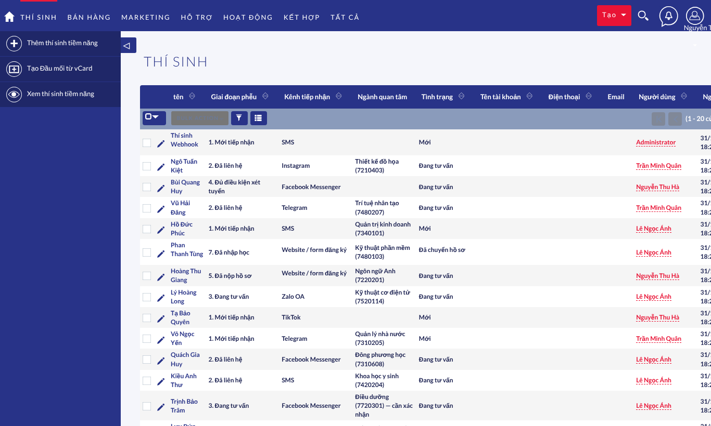

# VPU-CRM — Bản demo chạy trên máy (Docker)

Bản demo đầy đủ của VPU-CRM: theme VPU, tiếng Việt, phễu tuyển sinh đa kênh, 463 trường THPT/GDTX thuộc 4 tỉnh,
24 thí sinh mẫu, 1 tài khoản quản lý và 3 tài khoản tư vấn viên. **Toàn bộ thí sinh là dữ liệu giả.** Bản demo chỉ mở ở `localhost`,
không lộ ra mạng LAN.



## 1. Cần có
- Windows 10/11 cài **Docker Desktop** (bật WSL 2), đang chạy. Máy nên có ít nhất 4 GB RAM trống và khoảng 3 GB đĩa trống.
- Repo `vpu-crm` đã clone về `D:\NCKH-workflow\VPU-CRM`. Thư mục này chính là `09_DEMO` trong repo.

## 2. Chạy (PowerShell)
```powershell
cd D:\NCKH-workflow\VPU-CRM
git pull
cd 09_DEMO
.\start-demo.ps1
```
Lần đầu mất khoảng 5–10 phút để tải image và build, sau đó khoảng 40 giây để tự cài. Khi xong, script in danh sách tài khoản và mở
trình duyệt. Script **tự chọn cổng trống**: ưu tiên 8080, nếu cổng đang bị chương trình khác dùng thì thử 8081, 8090, 8180…
Cổng đã chọn được lưu vào `09_DEMO\.env` để các lần sau dùng lại.

Nếu PowerShell chặn script: `Set-ExecutionPolicy -Scope Process Bypass`, rồi chạy lại.

| Lệnh | Tác dụng |
|---|---|
| `.\start-demo.ps1` | Dựng hoặc khởi động, chờ sẵn sàng, in tài khoản, mở trình duyệt |
| `.\start-demo.ps1 -Port 8090` | Dùng cổng chỉ định |
| `.\start-demo.ps1 -Stop` | Dừng, giữ dữ liệu |
| `.\start-demo.ps1 -Reset` | **Xoá sạch** dữ liệu demo rồi dựng lại (mật khẩu mới) |
| `.\start-demo.ps1 -Accounts` | Xem lại tài khoản và mật khẩu |
| `.\start-demo.ps1 -ResetPasswords` | Đặt lại mật khẩu `admin`, `qlts01` và `tvts01..03` |
| `docker compose logs -f app` | Xem log |

Không dùng PowerShell thì chạy `docker compose up -d --build` trong thư mục này.

## 3. Tài khoản
Mật khẩu **sinh ngẫu nhiên ở lần cài đầu trên chính máy của bạn**, không có sẵn trong repo và khác với mọi mật khẩu gửi qua chat.
Xem bằng `.\start-demo.ps1 -Accounts`. Mật khẩu có dạng `Kt7m-Pq3H@48`, **không chứa nguyên âm, d, w**, nên gõ đúng
cả khi đang bật Unikey/EVKey (Telex, VNI).

| Tài khoản | Vai trò | Dữ liệu được chia |
|---|---|---|
| `admin` | Quản trị | toàn bộ |
| `qlts01` Phạm Thị Lan | Quản lý tuyển sinh | toàn bộ dữ liệu tuyển sinh |
| `tvts01` Nguyễn Thu Hà | Tư vấn tuyển sinh | trường và thí sinh Khánh Hòa |
| `tvts02` Trần Minh Quân | Tư vấn tuyển sinh | Lâm Đồng |
| `tvts03` Lê Ngọc Ánh | Tư vấn tuyển sinh | Đắk Lắk, Gia Lai |

Tư vấn viên xem và sửa được Thí sinh và Trường THPT, nhưng không xoá, nhập hay xuất dữ liệu, và không có quyền quản trị.
Quản lý tuyển sinh có thêm quyền xoá, nhập, xuất, báo cáo, chiến dịch, nhưng không vào được trang Quản trị.

**Tạo tài khoản, đặt lại mật khẩu:** đăng nhập `admin` → **Quản trị viên** → mục **VPU-CRM** ở đầu trang → **Tài khoản & mật khẩu**.
Tại đây tạo tài khoản Quản lý / Tư vấn / Quản trị, đặt lại mật khẩu, đổi loại, vô hiệu hoá. Mật khẩu mới chỉ hiện một lần, nên chép
lại ngay. Hãy mở trang bằng cách bấm từ trang Quản trị: SuiteCRM chặn trang quản trị khi mở thẳng bằng URL dán vào trình duyệt
(chống CSRF).

**Người dùng tự đổi mật khẩu:** bấm tên người dùng (góc phải trên) → **Đổi mật khẩu**. Tài khoản do admin tạo hoặc đặt lại với tuỳ chọn
"Bắt đổi mật khẩu" sẽ tự được đưa tới trang này ngay sau khi đăng nhập.

`-ResetPasswords` và `-Accounts` vẫn dùng cho tài khoản demo. Mật khẩu đã đổi trên giao diện thì `-Accounts` không biết; quên thì dùng
`-ResetPasswords` hoặc admin đặt lại.

## 4. Gợi ý kịch bản demo
1. Đăng nhập `tvts01`. Vào **Thí sinh**: xem giai đoạn phễu, kênh tiếp nhận, ngành theo mã Bộ GD&ĐT, trường THPT đã tự gắn.
2. Mở một thí sinh: panel **Tuyển sinh** và **Kênh tiếp nhận & đồng ý**; ghi chú hội thoại nằm trong mục Lịch sử.
3. Vào **Trường THPT**: lọc theo tỉnh, mở một trường để xem danh sách thí sinh của trường; cập nhật đầu mối và tình trạng tiếp cận.
4. Gửi thử một tin nhắn "SMS" vào webhook. Lấy khoá bằng
   `docker compose exec app grep -A0 "api_key" /state/config_override.php`, rồi chạy:
   ```powershell
   $key = '<api_key>'
   $body = '{"from":"0900000777","name":"Thí sinh thử","text":"Em có IELTS 6.5, xin học bổng ngành Logistics","high_school":"THPT Lý Tự Trọng","province":"Khánh Hòa"}'
   Invoke-RestMethod -Method Post -Uri 'http://localhost:8080/index.php?entryPoint=vpuInbound&channel=sms' `
     -Headers @{ 'X-VPU-Key' = $key } -ContentType 'application/json; charset=utf-8' -Body ([Text.Encoding]::UTF8.GetBytes($body))
   ```
   Thí sinh mới xuất hiện với ngành Logistics, học bổng Công dân toàn cầu, và được gắn với trường THPT Lý Tự Trọng.

## 4b. Kết nối kênh thật và nhập danh sách
- **Hướng dẫn cấu hình tài khoản** Facebook/Messenger, Instagram, form quảng cáo (Lead Ads), WhatsApp, Zalo OA, Telegram, SMS,
  Google Forms, TikTok, email…: [`02_DESIGN/KET_NOI_KENH.md`](../02_DESIGN/KET_NOI_KENH.md). Để thử với bản demo trên máy, mở
  tạm ra Internet bằng `cloudflared tunnel --url http://localhost:8080` (mục 0.2 của hướng dẫn).
- **Nhập danh sách Excel/CSV**, có 2 file mẫu trong `seed\samples\`:
  ```powershell
  docker compose cp .\seed\samples\mau_danh_sach_ngay_hoi.xlsx app:/tmp/ds.xlsx
  docker compose exec -u www-data -w /var/www/html app php custom/include/VPU/Import/import_leads.php --file=/tmp/ds.xlsx --channel=event --campaign="Ngày hội thử"
  ```

## 5. Cấu trúc
| File | Vai trò |
|---|---|
| `docker-compose.yml` | 2 dịch vụ: `db` (MariaDB 10.11), `app` (Ubuntu 24.04 + Apache + PHP 8.3); volume `db_data`, `app_state` |
| `Dockerfile`, `Dockerfile.dockerignore` | Image ứng dụng, lấy mã từ `suitecrm/` của repo; chỉ gửi `suitecrm/` và `09_DEMO/` vào build |
| `docker/setup.sh` | Lần đầu: silent install, tùy biến VPU (`post_deploy.php --seed`), thí sinh mẫu, tài khoản. Các lần sau: gắn lại cấu hình trong `/state` |
| `seed/seed_demo_leads.php` | 24 thí sinh giả, đi qua đúng luồng webhook (phân loại, ghép trường) |
| `seed/samples/` | File Excel/CSV mẫu (dữ liệu giả) để thử nhập lô |
| `start-demo.ps1` | Script tiện dụng cho Windows |

Đổi cổng khi không dùng script: tạo file `.env` trong thư mục này với nội dung `DEMO_PORT=8090` và `DEMO_SITE_URL=http://localhost:8090`.
Đổi cổng sau khi đã cài vẫn giữ nguyên dữ liệu; lúc khởi động, địa chỉ site được cập nhật theo cổng mới.

## Xử lý sự cố
| Thông báo | Nguyên nhân / cách xử lý |
|---|---|
| `ports are not available … bind: Only one usage of each socket address` | Cổng đang bị chương trình khác dùng (IIS, XAMPP, Tomcat, Jenkins, container cũ…). Chạy lại `.\start-demo.ps1` để script tự chọn cổng khác, hoặc dùng `-Port 8090`. Xem chương trình nào đang giữ cổng: `Get-NetTCPConnection -LocalPort 8080 -State Listen \| % { Get-Process -Id $_.OwningProcess }` |
| Đăng nhập báo sai mật khẩu | (1) Dùng mật khẩu của **bản demo trên máy mình** (`.\start-demo.ps1 -Accounts`), không dùng mật khẩu gửi qua chat. (2) Bản cũ (trước 31/10/2026) sinh mật khẩu có nguyên âm, Unikey/EVKey sẽ biến đổi khi gõ (vd. "aF" thành "à"): chạy `git pull`, `.\start-demo.ps1`, rồi `.\start-demo.ps1 -ResetPasswords` |
| `Docker Desktop chưa chạy` | Mở Docker Desktop, chờ biểu tượng chuyển sang "Running" |
| Trạng thái mãi `starting` | `docker compose logs app` rồi gửi log cho nhóm phát triển |
| `database đã có dữ liệu nhưng thiếu /state/config.php` | Volume bị lệch; chạy `.\start-demo.ps1 -Reset` |

## 6. Đã kiểm thử (31/10/2026, Docker 29, trên Linux)
- Dựng sạch: sẵn sàng sau 31–40 giây. 463 trường, 24 thí sinh mẫu (17 thí sinh tự gắn được trường), 4 tài khoản.
- Đăng nhập `admin` và `tvts01` qua http://localhost:8080; footer bản quyền VPU hiển thị.
- 01/11/2026: trang Tài khoản & mật khẩu, bắt đổi mật khẩu, menu Đổi mật khẩu (E2E 12/12); bản demo cũ khởi động lại tự có thêm `qlts01`.
- Webhook SMS nhận tin (khoá đúng) và trả 401 (khoá sai).
- `docker compose down` rồi `up`: dữ liệu và mật khẩu còn nguyên.
- Cổng 8080 bị chương trình khác chiếm: tái hiện được lỗi `bind`. Chuyển sang 8090 trên dữ liệu đã cài thì địa chỉ site và file tài khoản tự cập nhật, đăng nhập bình thường.

**Chưa kiểm thử trực tiếp trên Windows/Docker Desktop.** Các điểm đã tính trước cho Windows:
- file `.sh` được chuẩn hoá về LF khi build, nên cấu hình `autocrlf` của git không làm hỏng;
- `start-demo.ps1` được lưu dạng UTF-8 có BOM để PowerShell 5.1 đọc đúng tiếng Việt;
- `.gitattributes` cố định kiểu xuống dòng cho `.sh` và `.ps1`.
